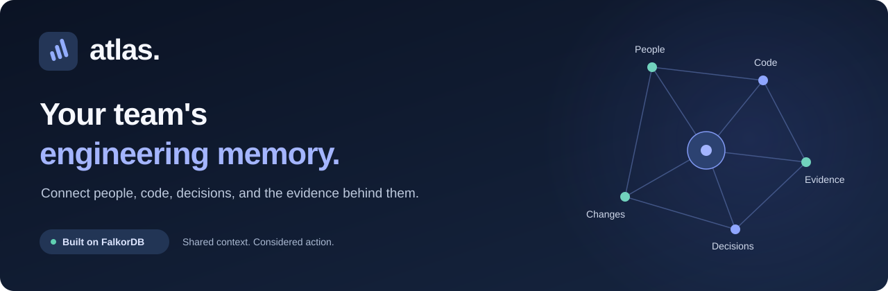
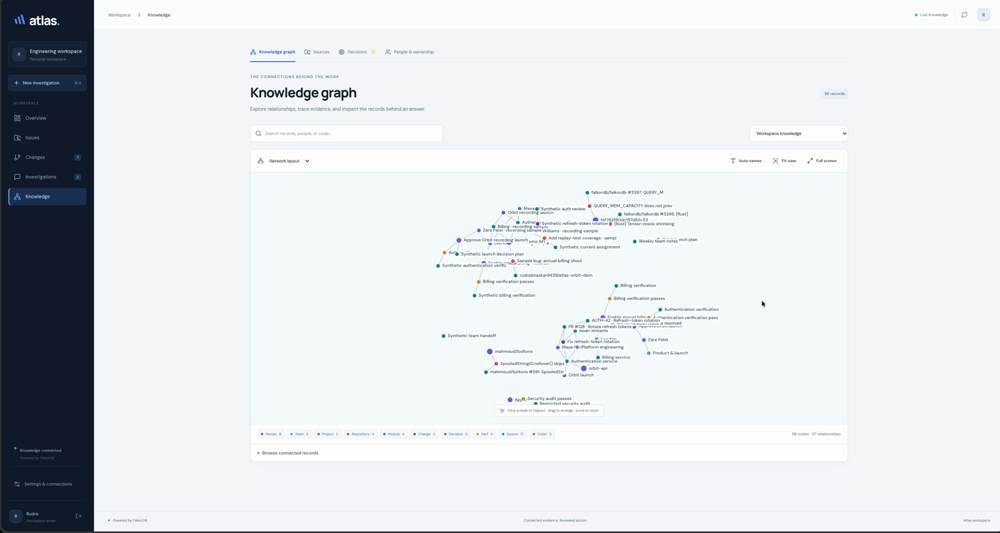
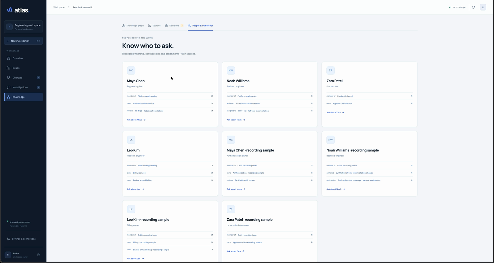
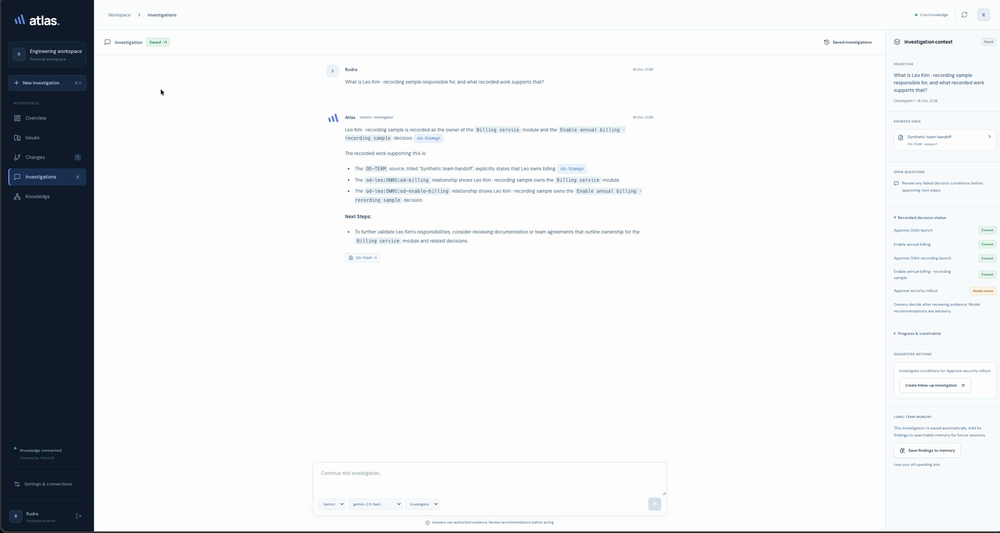
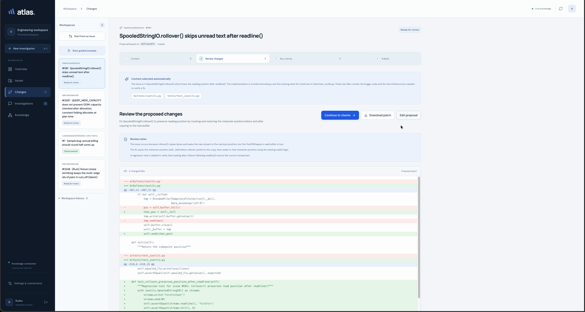
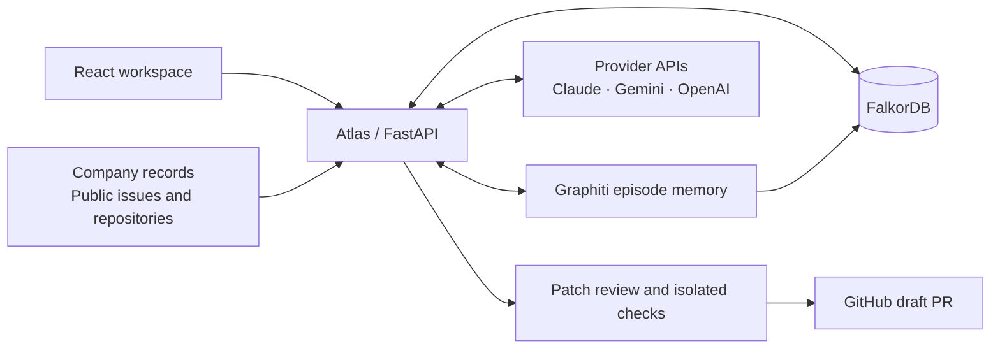

<p align="center">
  
</p>

<p align="center">
  <strong>Connect company knowledge to engineering action.</strong><br>
  People, code, decisions, and evidence — shared across your AI models.
</p>

<p align="center">
  <a href="https://github.com/FalkorDB/FalkorDB"></a>
  <a href="https://fastapi.tiangolo.com/"></a>
  <a href="https://react.dev/"></a>
  
</p>

<p align="center">
  <a href="docs/assets/atlas-demo.mp4"><strong>Watch the demo · 2:53</strong></a>
  &nbsp;·&nbsp;
  <a href="#run-locally">Run locally</a>
  &nbsp;·&nbsp;
  <a href="ARCHITECTURE.md">Architecture</a>
  &nbsp;·&nbsp;
  <a href="docs/TECHNICAL_REFERENCE.md">Technical reference</a>
</p>

---

## Understand the work before changing it

A repository shows the code. Understanding the work also means knowing who owns a service, which evidence supports a decision, and what context a teammate needs to continue.

**Atlas brings those relationships into one engineering workspace.** Ask questions grounded in recorded sources, carry an investigation from Claude to Gemini, and take a public GitHub issue through a reviewed proposal, isolated checks, and a draft pull request.

Project context persists in Atlas across model changes and application restarts.

## See it in action

[](docs/assets/atlas-demo.mp4)

**[Watch or download the narrated product walkthrough →](docs/assets/atlas-demo.mp4)**

The walkthrough combines clearly identified **sample company records** with a real issue-to-draft workflow in [mahmoud/boltons](https://github.com/mahmoud/boltons). It distinguishes passing isolated checks from native GitHub CI, which remains unverified for the draft.

<details>
<summary><strong>Explore the interface</strong> — ownership, evidence, and change review</summary>

### Know who to ask

Recorded ownership, contributions, and assignments stay connected to the people behind the work.



### Follow an answer back to its source

Investigations bring cited answers, source revisions, recorded decision status, and saved context into one view.



### Review the actual change

Inspect the proposed diff and regression coverage before running checks or approving publication.



</details>

## What you can do

| Capability | In the workspace |
| --- | --- |
| **Explore the company brain** | Navigate relationships between people, services, recorded changes, sources, and decisions. |
| **Ask with evidence** | Get answers grounded in accessible records, with source IDs and revisions for inspection. |
| **Track decision freshness** | Evaluate explicit evidence conditions and mark affected decisions as needing review when supporting records change. |
| **Continue across models** | Switch configured providers while retaining saved investigation history and checkpoints. |
| **Save useful findings** | Store selected findings as temporal episodes through Graphiti on FalkorDB. |
| **Understand a repository** | Index supported Python source with Code-Graph and explore its structure in the graph interface. |
| **Move from issue to draft** | Browse public issues, select relevant files automatically, review a proposed patch, run checks, and explicitly approve a draft PR. |

Recorded assignments describe what has been assigned. Ownership comes from supplied records; Atlas does not infer responsibility from commit counts.

## Built around FalkorDB

FalkorDB is the graph foundation for company knowledge, repository analysis, retrieval, and episode memory.



| Component | Responsibility |
| --- | --- |
| [FalkorDB](https://github.com/FalkorDB/FalkorDB) | Company graph storage, relationships, and graph queries. |
| [FalkorDB Code-Graph](https://github.com/FalkorDB/Code-Graph) | Repository source analysis and code graphs. |
| [FalkorDB GraphRAG SDK](https://github.com/FalkorDB/GraphRAG-SDK) | Document ingestion and graph-backed retrieval. |
| [FalkorDB Canvas](https://github.com/FalkorDB/falkordb-canvas) | Interactive graph visualization. |
| [Graphiti](https://github.com/getzep/graphiti) | Temporal episode memory using its FalkorDB driver. |
| [LiteLLM](https://github.com/BerriAI/litellm) | Model-provider routing. |
| React, TypeScript, Vite | The workspace interface. |
| FastAPI, SQLite, Docker | Application API, local application state, and the isolated check runner. |

See [the architecture](ARCHITECTURE.md) for schemas, permission boundaries, evidence revisions, and the publication flow.

## Run locally

**Requirements:** Docker running, Node.js 20+, Python 3.12 or 3.13, and [uv](https://docs.astral.sh/uv/).

```bash
git clone https://github.com/RudraBhaskar9439/atlas-engineering-workspace.git
cd atlas-engineering-workspace

./scripts/setup.sh
./scripts/start.sh
```

Open **[localhost:8001](http://localhost:8001)**.

The setup script creates `.env` from [`.env.example`](.env.example) when it is missing, installs dependencies, starts FalkorDB, and builds the frontend. The start script builds and launches Atlas and its internal check runner.

Choose **Explore demo workspace** to load the fictional Orbit environment when demo access is enabled. The **read-only demo** shows the restricted viewer experience.

| Connection | Configuration |
| --- | --- |
| **Live model answers** | Add provider API keys in **Settings** or configure `ANTHROPIC_API_KEY`, `GEMINI_API_KEY`, and/or `OPENAI_API_KEY` in `.env`. |
| **Google sign-in** | Set `GOOGLE_CLIENT_ID` and `GOOGLE_CLIENT_SECRET`; authorize `http://localhost:8001/auth/google/callback` in your web OAuth client. |
| **GitHub publication** | Connect GitHub in **Settings → GitHub** with repository-appropriate permissions. See [credential setup](docs/TECHNICAL_REFERENCE.md#credentials-and-login). |
| **Model spend limit** | Configure `ATLAS_API_CAP_INR`. Atlas reserves estimated API spending; provider invoices remain the source of truth. |

Provider API billing is separate from ChatGPT, Claude, and Gemini consumer subscriptions. Google sign-in authenticates you to Atlas.

FalkorDB Browser is available at [localhost:3001](http://localhost:3001). The default setup binds services to localhost and persists state in a Docker volume and `.atlas-data/`.

## Take your first tour

1. **Explore Knowledge.** Open the graph, then **People & ownership** to inspect the sample team's relationships.
2. **Start an investigation.** Ask: “Who owns authentication, who authored the refresh-token change, and what evidence supports that?”
3. **Switch models.** Continue the saved investigation with another configured provider.
4. **Inspect a decision.** Follow its supporting conditions and source records. See the [recording guide](DEMO.md) for the sample evidence-change scenario.
5. **Open a public issue.** Use **Issues → Open change workspace**, review the proposed diff, run the appropriate checks, and review publication before creating a draft.

For a controlled code example, use the explicitly labeled [Orbit demo repository](https://github.com/RudraBhaskar9439/atlas-orbit-demo). For the real repository shown in the video, use [Boltons](https://github.com/mahmoud/boltons).

## Development

```bash
uv run pytest -q
uv run ruff check atlas tests scripts
npm --prefix frontend test
npm --prefix frontend run build
```

For frontend development, run `npm --prefix frontend run dev` with the backend running; Vite proxies API calls to port 8001.

The [technical reference](docs/TECHNICAL_REFERENCE.md#tests-and-api-budget) covers integration checks, API budgets, and saved evaluation reports.

## Current scope

- **Company records are explicit inputs.** The included Orbit people and assignments are fictional. Real ownership requires supplied team records. GitHub issue reporters and assignees are imported; a complete commit/blame/CODEOWNERS attribution graph is not implemented.
- **Repository analysis and checks have defined limits.** The current source-analysis setup targets Python. Isolated checks run offline in restricted containers; native GitHub workflows remain subject to repository and fork policies.
- **Publication requires review.** Isolated checks and native CI have separate statuses. An unverified draft requires explicit approval and discloses its validation state. Atlas never merges the PR.
- **This is a local development preview.** Public deployment requires the HTTPS, authentication, account-allowlist, and demo-access configuration described in the [technical reference](docs/TECHNICAL_REFERENCE.md#credentials-and-login).

## Documentation

| Guide | What it covers |
| --- | --- |
| [Architecture](ARCHITECTURE.md) | System design, graph schema, permissions, and data flow. |
| [Technical reference](docs/TECHNICAL_REFERENCE.md) | Detailed setup, imports, queries, integrations, validation, and implementation limits. |
| [Demo guide](DEMO.md) | Sample company records, evidence scenarios, and recording instructions. |
| [Submission notes](SUBMISSION.md) | Hackathon positioning and project summary. |
| [Third-party components](THIRD_PARTY.md) | Dependencies, upstream licenses, and AI-assistance attribution. |

---

Built for the [FalkorDB hackathon](https://www.wemakedevs.org/hackathons/falkordb) by [RudraBhaskar9439](https://github.com/RudraBhaskar9439).
