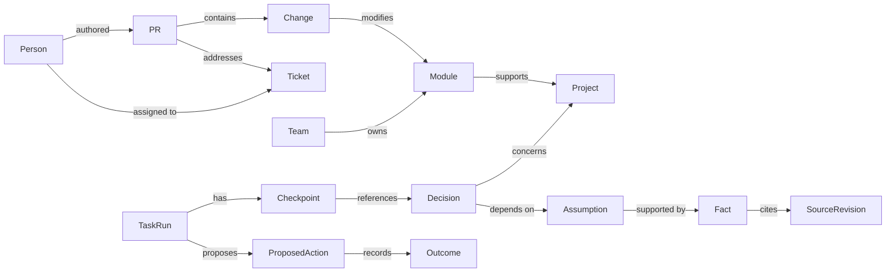
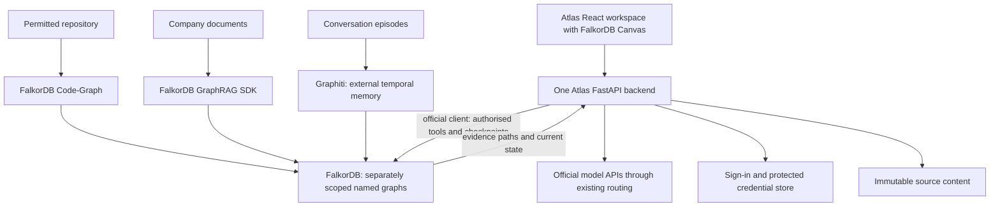

# Atlas Company Brain Project Specification

> Original planning specification. Current implementation, verified behavior, and limits are documented in `README.md`, `ARCHITECTURE.md`, and `outputs/atlas-evaluation.json`. Public issue review, patch validation, GitHub CI, and approved draft PR workflows were added during implementation.

Atlas is a proposed workspace that connects company knowledge, software changes, people, decisions, and ongoing work. Users can ask questions through GPT, Claude, or Gemini while Atlas maintains a shared graph and durable task state. When evidence changes, Atlas identifies decisions that need review and helps the responsible people revise the work.

This document consolidates the final project concept, proposed technical approach, hackathon scope, demonstration, and acceptance criteria. It is a planning specification, not a completed application or a claim of measured performance. The hackathon runs October 15 through October 18, 2026, in IST. Its rules reserve the main coding and design work for that window; ideas, notes, graph sketches, and diagrams are permitted beforehand.

## Product purpose

Company information is spread across repositories, documents, tickets, conversations, and people. A useful answer often requires following the relationships between those records. A remembered answer can also become outdated when its supporting evidence changes.

Atlas should answer three connected questions: what do we currently know, what does a change affect, and who can act on it? Its defining capability is preserving the reasons behind work and recognising when those reasons need review, including during a model switch or application restart.

The initial audience is a small engineering organisation with product and engineering teams. The underlying graph should remain reusable across company workflows. The hackathon demonstration will prove it through one product launch involving code, tickets, ownership, and customer commitments.

## Track entries

| Track | Contribution to demonstrate |
| --- | --- |
| Company Brain | Connect people, teams, projects, repository changes, documents, tickets, and decisions. Explain ownership and consequences with sources. Keep knowledge current as evidence changes. |
| Agent Memory and Coordination | Preserve evidence and task checkpoints across sessions, restarts, and model switches. Demonstrate two agents handing off work through shared state while handling stale updates. |

Company Brain is the primary entry because it matches the intended product and the advertised Mac mini prize. The same project can enter both tracks under the published rules. Model selection and interface polish support the product; the graph and memory behaviour provide the substantive contribution.

Closely related systems already exist, including Palantir, Glean, and Graphiti. Atlas should be presented as an original implementation with a demonstrated improvement, rather than a first-ever company brain. No concept score or feature list establishes a probability of winning.

## Complete user experience

1. Sign in to Atlas and open a company workspace.
2. Connect an AI provider using its API key. Add other providers independently.
3. Import the permitted repository and company source records.
4. Select a model from the models Atlas supports for that provider.
5. Ask a question or start a task.
6. Inspect the answer, its source citations, and the graph paths supporting it.
7. Open a person, component, ticket, or decision to inspect the relevant details.
8. Switch models at a safe task boundary and continue from the saved checkpoint.
9. Review new evidence and the decisions Atlas flags as affected.
10. Approve proposed task changes inside Atlas and inspect the recorded outcome.

For the hosted demonstration, users can explore a synthetic company workspace. A complete local setup should also support importing a permitted repository. Provider connection, import, empty, loading, unavailable, and failure states must have understandable explanations.

## Workspace layout

The interface should use the familiar navigation and conversation structure of a coding workspace with Atlas branding. The final UI assets and implementation will be created during the event.

| Area | Content and interactions |
| --- | --- |
| Workspace sidebar | Company and project selection, repositories, documents, tickets, saved conversations, and tasks. |
| Conversation area | Question box, model picker, streamed response, cited sources, tool progress, and task status. |
| Graph area | Relevant entities and relationship paths for the current question, with search, zoom, selection, and source inspection. |
| Source inspector | Document passages, ticket history, commit information, PR details, or code excerpts at the cited revision. |
| Person view | Team membership, recorded responsibilities, authored changes, reviews, assigned work, and last update times. |
| Decision view | Current status, assumptions, supporting evidence, owner, affected work, and revision history. |
| Memory and task view | Saved conclusions, evidence references, completed steps, pending actions, unresolved questions, and handoff history. |
| Provider settings | Provider connections, supported model selection, connection checks, and actionable errors. |

The default graph should display the subgraph relevant to the current question. A broader company graph can be explored separately. Every relationship presented as supporting an answer should correspond to retrieved graph evidence.

## Sponsor-first component policy

Use FalkorDB-owned components wherever they cover a required function. FalkorDB is the sponsor ecosystem verified on the hackathon resources page. A framework appearing in its integration documentation is not automatically a FalkorDB-owned product.

The final foundation is FalkorDB, GraphRAG SDK, Code-Graph, Canvas, and the official Python client. Use the sponsor's MCP tools only when an external MCP client needs access. Avoid another graph database or vector store, overlapping memory frameworks, and extra orchestration frameworks.

FalkorDB supplies durable graph storage and native search. GraphRAG SDK supplies knowledge ingestion and retrieval. The official agentic-memory documentation recommends external frameworks for temporal agent memory; it specifically recommends Graphiti for temporal reasoning and multi-agent memory. The documentation checked does not establish a sponsor-owned replacement for that temporal memory engine. Therefore Graphiti is the one external memory framework in this plan, with its native FalkorDB backend. It is an explicit gap filler, not a sponsor-owned component. Mem0 and Cognee are unnecessary alongside it.

Persistent storage alone does not implement memory reconciliation, task checkpoints, or model handoffs. Atlas stores its structured workflow state directly in FalkorDB; Graphiti handles temporal conversational episodes. No memory framework substitutes for Atlas's access checks or workflow rules.

## Provider connections

The initial supported providers are OpenAI, Anthropic, and Google. Use their official APIs. Reuse the LiteLLM integration already used by Code-Graph and supported by GraphRAG SDK for Atlas chat routing, rather than building three parallel routing systems. LiteLLM is external software that fills the model-routing gap; FalkorDB does not supply inference models. Use Graphiti's supported provider clients for its own extraction pipeline.

| Provider | Connection in the initial Atlas build | Models |
| --- | --- | --- |
| OpenAI | OpenAI API key | GPT models supported by Atlas and available to the account. |
| Anthropic | Anthropic API key | Claude models supported by Atlas and available to the account. |
| Google | Gemini API key | Gemini models supported by Atlas and available to the account. |

Discover models where the provider supports it and filter them by capabilities Atlas implements. A listed model is a candidate, not proof that every request will be permitted. Handle billing, quota, permission, unavailable-model, and unsupported-feature errors.

Pass a user's provider credentials explicitly to that user's requests. Do not switch process-wide environment variables to change models or keys in a shared server. The ingestion and embedding configuration is separate from the chat model picker. Keep one embedding model and dimension per index; changing the chat model must not change stored vector spaces. Changing an embedding model requires a deliberate re-index.

Google sign-in authenticates the person to Atlas. It does not authorise OpenAI or Anthropic inference or transfer subscription allowances between services. Connecting a provider does not automatically import private consumer-app conversations. The initial implementation uses API billing, not consumer subscription tokens.

OpenAI documents an additional ChatGPT plan-usage route for eligible users of open-source, locally hosted apps; remotely hosted or paid use has a separate partner-access path. This is a later integration. Anthropic does not permit a custom application's own requests to be routed through consumer Claude.ai credentials; hosting unmodified Claude Code is a separate integration. Google documents separate billing for external Gemini API use.

Additional providers are later extensions, after their authentication, model capabilities, and terms are verified.

## Source records and identity

| Source | Implementation | Information Atlas can establish |
| --- | --- | --- |
| Repository files and Git history | FalkorDB Code-Graph | Supported files, classes, functions, calls/imports/inheritance, and Git history. |
| PR and ticket records | Structured JSON import into Atlas's FalkorDB graph | Author, reviewer, assignee, status, linked changes, and recorded explanations. |
| Company documents | FalkorDB GraphRAG SDK | Source chunks, extracted entities/relationships, and retrieval provenance. |
| Permitted conversation episodes | Graphiti with FalkorDB | Temporal conversational facts and episode references. |
| Ownership and identity records | Explicit structured import and Atlas mappings | Component/team ownership and resolved identities. |

Reuse Code-Graph's repository analysis instead of writing another AST parser. Its documented enabled analyzers cover Python, Java, and C#; the hackathon fixture uses Python. Static analysis must not be presented as a complete runtime call graph. Verify Git history fields on the pinned version. Git metadata does not by itself establish PR reviews, ticket assignments, or authoritative business ownership. Add those through explicit records. Use ordinary Git commands only for required metadata the chosen Code-Graph version does not expose, such as line attribution.

Use GraphRAG SDK for company-document ingestion, ontology-guided extraction, entity resolution, native search, and retrieval context. Its documented MENTIONED_IN relationships connect extracted entities to source chunks. Resolve these to immutable Atlas source revisions before presenting citations. Source provenance shows where a claim came from; it does not prove that the claim is true.

Use structured records for authoritative statuses, identities, ownership, and confirmed decision dependencies. Model-extracted links remain candidates until validated. Do not send the same company documents through Graphiti as a second ingestion pipeline. Graphiti receives conversational episodes and memory updates only.

The demo uses synthetic records. Initial loaders accept a permitted repository, Markdown documents, and structured JSON records. Live Slack, Jira, GitHub PR sync, and consumer-chat access are later integrations.

Map Git authors, PR users, and ticket assignees to people through explicit identity mappings. Preserve unresolved identities. Keep author, reviewer, owner, and suggested expert distinct. A person's work view reports recorded assignments and their last update times; it does not infer private activity or availability.

## Logical graph sketch

This is Atlas's application-level schema for relationships, decision dependencies, and workflow state. Code-Graph, GraphRAG SDK, and Graphiti retain their own supported schemas in separately named FalkorDB graphs within each access scope. Do not mix reserved schemas or assume that named graphs can be joined with one Cypher query.

Use stable Atlas identifiers and reference records containing the source graph, entity identifier, and immutable source revision. Atlas's dependency graph contains only the references and relationships needed for its business queries. The backend resolves authorised references to code, document, and episode evidence and combines results for the answer. It must enforce access before selecting any graph. Do not build a general graph-federation framework for the demo.

| Entity | Purpose |
| --- | --- |
| Person and Team | Identity, membership, responsibilities, and recorded work. |
| Project and Repository | Work context and source code. |
| Module and Change | Supported code structure and recorded modifications. |
| PR and Ticket | Explanation, review, status, assignment, and work history. |
| SourceRevision | Immutable evidence reference with source identifier, revision, location, and observation time. |
| Fact and Assumption | Versioned claims and the conditions behind a decision. |
| Decision | Owner, evidence dependencies, current status, and history. |
| TaskRun and Checkpoint | Durable progress and the evidence versions used by an agent. |
| ProposedAction and Outcome | Proposed mutations, approval, execution status, and recorded results. |

Core graph queries must retrieve ownership and work relationships, paths supporting an answer, decisions depending on changed evidence, and authorised task checkpoints. Dependency traversal should handle cycles and report any traversal limits. Similar wording or a shared topic alone must not be treated as proof that one decision depends on another.

## Updating evidence and decisions

1. Persist an immutable source revision and its original content before updating any derived index.
2. Use GraphRAG SDK's documented update(), delete_document(), and apply_changes() operations for the current document index. Its content-hash checks can avoid reprocessing unchanged documents. Verify these APIs in the pinned version during the event; README features may be ahead of a released package.
3. Use Code-Graph to analyse the selected repository revision. Preserve the commit identifier on Atlas evidence references; a mutable current code index is not a historical archive.
4. Read structured changes or extract candidate claims and link them to source revisions. Mark superseded Atlas claims while retaining their history.
5. Follow confirmed dependencies from changed claims to assumptions, decisions, and tasks using native Cypher queries in the Atlas graph.
6. Mark affected decisions as needing review. Contradictory evidence triggers review, not an automatic declaration that a decision is wrong.
7. Explain affected paths, cite changed evidence, identify recorded owners, and propose next steps.
8. Record an approved decision revision or task update with its source and outcome.

Run document updates serially in the first build, respecting the SDK's documented concurrency limitations. Derived-index cleanup must not erase Atlas's immutable evidence history. The SDK's incremental updates do not automatically implement business-decision invalidation or a complete temporal memory service.

Use three initial decision states: current, needs review, and superseded. Distinguish confirmed dependencies from inferred candidates. A suggested link must not silently trigger an authoritative business action.

Historical answers retain the source versions they originally used. New answers and resumed tasks retrieve current evidence. Missing, deleted, conflicting, or incomplete records produce a visible gap and a review request. Use SDK retrieval-only context and allow Atlas to abstain when support is insufficient. Prefer explicit, bounded graph tools for core queries; do not depend on experimental text-to-Cypher generation for permissions or critical decisions.

## Persistent memory and model handoffs

Use three distinct responsibilities:

| Responsibility | Implementation |
| --- | --- |
| Current company knowledge and source retrieval | FalkorDB GraphRAG SDK and Code-Graph. |
| Temporal conversational facts and episode memory | Graphiti with its native FalkorDB backend, through direct integration. |
| Exact task progress, approvals, evidence versions, and handoff state | Atlas records stored directly in FalkorDB through the official Python client. |

Graphiti is external, as documented in the sponsor-first policy. Limit it to the temporal memory function missing from the checked sponsor-owned tools. Its extracted beliefs are not authoritative ticket state or task completion. Atlas supplies business dependencies, permissions, checkpoint rules, and handling of changed evidence.

Each committed checkpoint contains:

- Task identifier, objective, current status, and revision.
- Completed steps and recorded outcomes.
- Current conclusions, constraints, and unresolved questions.
- Evidence identifiers and source versions used.
- Pending proposals and stable action identifiers.
- Provider/model metadata and audit history.
- Scope and access requirements.

Store structured task state separately from optional narrative summaries and Graphiti's derived memory. Preserve observable evidence, conclusions, and progress; do not require hidden model chain of thought or promise identical answers across providers.

On a model switch, stop at a safe boundary, finish or record in-flight tool work, and commit a checkpoint. The new model receives that checkpoint, currently authorised company evidence, and relevant episode memory. If referenced evidence changed, revalidate the affected conclusion before continuing. An unrelated graph update must not invalidate the entire task. Model changes do not clear memory or rebuild indexes.

Commit exact task state before deriving episode memory. Use a stable episode-ingestion identifier and an explicit pending/completed status so a crash between these steps can be detected and retried without losing workflow progress. Do not claim a single atomic transaction across separate graphs or frameworks.

Configure FalkorDB persistence and a persistent Docker volume, then test application and database restart recovery. Atlas identifies an interrupted action as pending or uncertain when no outcome was committed, rather than silently describing it as completed.

## Agent coordination and actions

Use two agent roles in the demonstration: an investigator that gathers evidence and a planner that proposes the response. They may use different providers. Their handoff occurs through saved task state and graph records.

Keep one backend process for the initial deployment and serialize commits for each task. Check the expected task revision before accepting a state update; a stale update must be rejected and revalidated. Agents should not silently overwrite each other's progress.

The initial actions are local Atlas task and decision updates. Each proposal records its target, owner, evidence, expected revision, and action identifier. A user approves the proposal before mutation. Repeated approval with the same action identifier should return the recorded outcome rather than create duplicate work. Validate this behaviour during implementation.

External ticket creation, email, messaging, and repository writes are later integrations. Their failure and retry behaviour requires separate verification. The hackathon demonstration should not imply that a proposed action has already been performed externally.

## Access and credential handling

Use separately scoped graphs for company-shared knowledge, restricted project knowledge, and private user memory. The backend must verify membership and authorisation before selecting graphs, executing queries, retrieving citations, resuming tasks, or sending context to a model.

Evidence derived from restricted information stays in a compatible restricted scope. Store conversation and checkpoint content according to the most restrictive evidence used. Changes to membership or access should take effect on subsequent retrieval and task resumption.

Keep provider keys out of the graph, conversation text, prompts, and logs. Store encrypted credentials or secret references on the backend, separately from company knowledge. Provide disconnect and credential replacement controls. Validate Atlas sessions through a standard authentication library and use secure session cookies in deployment.

Repository import must be read-only. Validate supported locations, paths, archive contents when applicable, and size limits. Never execute repository code merely to build the graph. Treat imported text as evidence rather than instructions that can change the agent's tool policy.

## Final technical stack and component ownership

| Function | Final choice | Ownership and boundary |
| --- | --- | --- |
| Core relationship storage | FalkorDB, local Docker first; FalkorDB Cloud for a hosted database | Sponsor-owned. Holds knowledge, dependencies, memory, and workflow state. Cloud hosts the database, not the entire Atlas web app. |
| Repository analysis and Git history | FalkorDB Code-Graph | Sponsor-owned, MIT-licensed foundation. Reuse its analyzers and repository operations; prove the Python fixture. |
| Document ingestion and retrieval | FalkorDB GraphRAG SDK | Sponsor-owned, Apache-2.0. Handles ontology-guided extraction, source-chunk provenance, search, and documented incremental updates. |
| Semantic, keyword, and property lookup | FalkorDB native vector, full-text, and range indexes | Sponsor-owned. No separate vector database. Embedding generation still requires a model provider. |
| Ownership, change consequences, and dependency paths | Native Cypher through the official FalkorDB Python client | Sponsor-owned tools plus original Atlas queries and dependency rules. |
| Graph panel | FalkorDB Canvas, @falkordb/canvas | Sponsor-owned component with documented React/TypeScript integration, selection, zoom, pan, and layouts. |
| Query inspection and debugging | FalkorDB Browser | Sponsor-owned admin/developer tool; keep it separate from Atlas's ordinary user access. |
| External MCP client access, if needed | Code-Graph's bundled MCP tools for code; official FalkorDB MCP server for graph access | Sponsor-owned. Optional after the main demo passes. Use the narrowest tool set and authorised graph scope. Read-only mode alone is not per-user authorisation. |
| Temporal episode memory | Graphiti, graphiti-core[falkordb] | External gap filler explicitly recommended by FalkorDB for temporal/multi-agent memory. No Mem0 or Cognee alongside it. |
| Durable checkpoints, handoffs, and action records | Atlas schema and small workflow logic in FalkorDB | Original application functionality. Graph storage is supplied by the sponsor; workflow semantics must be implemented and checked. |
| Multi-provider chat | Reuse Code-Graph's LiteLLM integration and GraphRAG SDK's supported adapter | External inference-routing library already used by sponsor tooling. Call official provider APIs with independently supplied keys. |
| Workspace application | Adapt Code-Graph's React/TypeScript/Vite and FastAPI/Python foundation | Reuse the sponsor's existing app repository during the event, then implement Atlas's views and workflow. Generic web libraries remain external dependencies. |
| User sign-in and app permissions | Maintained OIDC library such as Authlib; explicit Atlas scope checks | External authentication gap plus Atlas policy. Code-Graph's shared token and Browser roles do not supply the complete Atlas user/tenant model. |
| Sessions and protected credentials | SQLite for non-graph app records, maintained encryption library, key outside the database | Supporting storage only. Provider keys never enter the knowledge graph, prompts, or logs. |
| Raw historical source content | Local files in a persistent volume, referenced by SourceRevision | Standard filesystem; no additional storage service is needed for the demo. |
| Reproducible setup | Adapt Code-Graph's Docker Compose setup with persistent volumes | Existing sponsor-repository setup plus ordinary container tooling. A complete local setup satisfies the published deployment option. |

FalkorDB remains essential: removing it breaks relationship retrieval, decision-impact analysis, temporal memory, and workflow recovery. Supporting SQLite records must not become an alternative graph implementation.

Use one application backend, not separate web apps for every component. Integrate the three ingestion responsibilities without duplicating document extraction. Pin mutually compatible versions, retaining licences and attribution. Code-Graph's current repository describes legacy tests needing maintenance; do not assume the template is already production-ready or that all upstream checks pass. Verify the features Atlas actually uses on the pinned revision during the event.

Do not add QueryWeaver for this scope: its text-to-SQL function is irrelevant without a relational business-data source. Do not add LangChain, LangGraph, AG2, or LlamaIndex merely because they appear in the integration catalogue. The initial investigator/planner handoff needs saved task state, bounded tools, and one backend, not another orchestration framework. Avoid building a custom MCP server when sponsor tools cover the required external-client use.

## Hackathon build scope

The required build is one complete workspace for one synthetic organisation, with one repository, company documents, tickets, PR records, and explicit ownership. It includes the conversation UI, graph exploration, source inspection, person and decision views, and task memory.

Support all three named providers through the reused routing integration. Prove the main handoff using two providers and smoke-check the third. Provider discovery and model selection must only advertise capabilities implemented by Atlas.

The company fixture should contain two teams, two projects, several synthetic employees, one Python repository, and a small set of linked documents, tickets, and PRs. Include a restricted project scope and a separate private-memory example. During the event, create the repository and fixture records with enough revisions to exercise changing evidence.

Keep the first build focused on this data contract and supported repository language. Live enterprise connectors, additional providers, additional language parsers, distributed agents, a full code editor and terminal, and consumer subscription integrations are later extensions.

## Demonstration scenario

The synthetic company is preparing a product launch. A launch decision depends on the authentication issue being resolved. A PR modifies the authentication module and links to that issue. The records identify its author, reviewer, component owner, and launch owner.

1. Ask who changed authentication, why, what they are assigned to, and which launch decision depends on the change. Atlas answers with sources and highlights the supporting graph paths.
2. Have the investigator gather evidence and save a checkpoint. Show the completed work and unresolved question in the task view.
3. Restart the application and recover that committed checkpoint.
4. Import a new ticket revision containing a regression report. It contradicts the earlier resolved-state evidence. Atlas marks the linked launch decision as needing review and shows the affected dependencies and owner.
5. Switch from Claude to Gemini, or another tested provider pair. The planner resumes from the checkpoint, recognises the changed evidence, and proposes an investigation task with sources and ownership.
6. Approve the local task proposal. Show its recorded outcome and demonstrate that repeated approval does not duplicate it.
7. Change an unrelated source record. Confirm that Atlas does not flag unrelated decisions.
8. Use the restricted demo account to confirm that inaccessible evidence is absent from answers, graph paths, citations, and recovered memory.

The audience should be able to inspect the records and introduce another change. Prepare a short recorded walkthrough and keep the full local setup available in case a provider or deployment is temporarily unavailable.

## Acceptance and evaluation

Prepare a small set of synthetic scenarios with expected relationships, affected decisions, permissions, and task outcomes. Separate deterministic graph and state checks from the quality of the model's explanation.

| Check | Required evidence |
| --- | --- |
| Provenance | Claims about changes, ownership, and decisions link to accessible source revisions. |
| Dependency analysis | Expected affected decisions are found, and unrelated decisions are left unchanged. |
| Changing evidence | A resumed task uses the new evidence and identifies the previous conclusion as requiring review. |
| Restart recovery | Committed objective, progress, evidence, pending actions, and unresolved questions survive restart. |
| Model handoff | The receiving model can continue from the structured checkpoint without relying solely on a summary. |
| Coordination | A stale task revision cannot overwrite newer committed work. |
| Actions | Repeated approval of the same local action does not duplicate the mutation. |
| Permissions | Restricted evidence is absent from retrieval, output, graph inspection, citations, and memory for unauthorised users. |
| Provider failures | Invalid keys, unsupported models, limits, and interrupted requests produce actionable states without corrupting task progress. |
| Central graph use | The application depends on FalkorDB for its graph analysis and workflow memory. |

Compare the relevant question and change scenarios with straightforward retrieval from the same authorised documents without the explicit dependency queries. Use the same model and comparable request budgets. Report the scenario count, affected-decision precision and recall, outdated evidence reused, checkpoint fields lost, duplicate mutations, and permission failures. Measure latency and request cost where practical.

These are planned measurements. Publish actual results after running the checks, including failures and limits. Do not invent benchmark improvements or describe the small fixture as evidence of production readiness.

## Build sequence

Before October 15, prepare notes describing the graph, source contracts, demonstration, and expected evaluation cases. The main coding and design work starts when the event opens.

| Date in IST | Work and exit condition |
| --- | --- |
| October 15 | Implement the scoped data pipeline, FalkorDB integration, and essential graph queries. Trace one code change to its owner and decision with evidence. |
| October 16 | Implement source revisions, decision review, task checkpoints, and the first two provider integrations. Pass a restart and handoff check. |
| October 17 | Complete the workspace views, person context, coordination, access checks, and third provider adapter. Run the full demonstration and fix failures. |
| October 18 | Finish evaluation, setup documentation, AI assistance disclosure, deployment or local package, demo video, and submission. Leave time before the 11:59 PM IST deadline. |

Use the working end-to-end path as the priority throughout the event. The complete submission depends on demonstrated behaviour and reproducible setup, not the number of screens or connectors.

## Submission deliverables

- A public repository containing the original implementation completed during the event.
- A README explaining the product, setup, required credentials, supported data, and limitations.
- The actual graph model and the Cypher queries or graph algorithms the product depends on.
- Synthetic demo data and the evaluation scenarios with actual results.
- A demo video showing source tracing, changed evidence, restart recovery, model handoff, and coordinated task updates.
- A live deployment or complete local setup instructions.
- Explicit entries for Company Brain and Agent Memory and Coordination.
- Disclosure of AI assistance and third-party components, with applicable attribution and licences.

Participants must understand and be able to explain the submitted architecture, graph model, queries, and technical choices. Recheck the rules before the event because the organiser says they may be updated.

## Sources

Sponsor capabilities and ownership were checked for this planning update on October 5, 2026. Recheck documentation and compatible package versions when the event opens.

- [Hackathon resources](https://www.wemakedevs.org/hackathons/falkordb/resources)
- [Hackathon tracks and prizes](https://www.wemakedevs.org/hackathons/falkordb#tracks)
- [Hackathon rules](https://www.wemakedevs.org/hackathons/falkordb/rules)
- [FalkorDB documentation and native indexes](https://docs.falkordb.com/)
- [GraphRAG SDK source, capabilities, and licence](https://github.com/FalkorDB/GraphRAG-SDK)
- [Code-Graph documentation](https://docs.falkordb.com/genai-tools/code-graph)
- [Code-Graph source and MIT licence](https://github.com/FalkorDB/Code-Graph)
- [FalkorDB Canvas React integration and API](https://docs.falkordb.com/browser/canvas)
- [FalkorDB Browser](https://docs.falkordb.com/browser)
- [Official FalkorDB MCP server](https://docs.falkordb.com/genai-tools/mcpserver)
- [FalkorDB agentic-memory recommendations](https://docs.falkordb.com/agentic-memory/index)
- [Graphiti source and licence](https://github.com/getzep/graphiti)
- [Graphiti on FalkorDB](https://docs.falkordb.com/agentic-memory/graphiti)
- [OpenAI ChatGPT plan usage in open-source apps](https://developers.openai.com/siwc/token-sharing-open-source)
- [OpenAI website sign-in](https://developers.openai.com/siwc/website)
- [Anthropic authentication and credential use](https://code.claude.com/docs/en/legal-and-compliance#authentication-and-credential-use)
- [Google AI plans and Gemini API usage](https://ai.google.dev/gemini-api/docs/google-ai-plans)
- [Palantir agents and decisions](https://blog.palantir.com/connecting-agents-to-decisions-277dee8ddb40)
- [Glean context graphs](https://www.glean.com/blog/how-do-you-build-a-context-graph)
